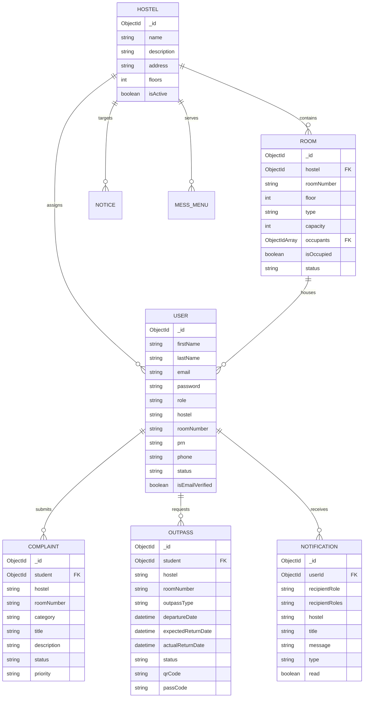
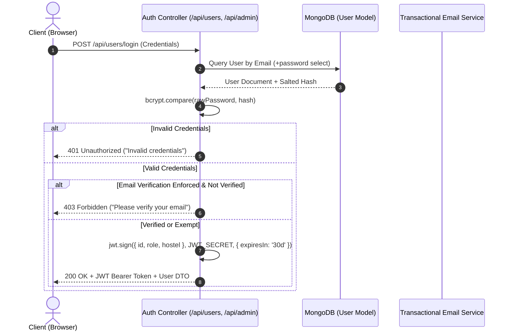
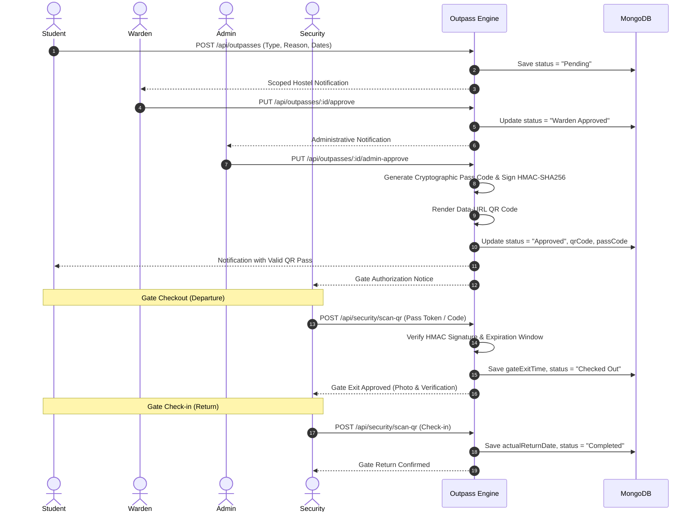

# Architecture & Technical Design Specification

**Platform:** Hostel Management System (HMS)  
**Version:** 1.0.0 Production Architecture  
**Author:** Full-Stack Engineering Team  

---

## 1. System Overview

The Hostel Management System is a multi-tier, role-based accommodation management platform designed to automate the administrative, logistical, and security workflows of multi-hostel campuses.

The architecture separates concerns into a reactive Single Page Application (SPA) frontend, an event-driven RESTful API gateway backend, a document-oriented MongoDB persistence layer, and external transaction-oriented SMTP notification services.

```mermaid
graph TD
    subgraph Client Layer
        WebClient["Web Browser (React 18 + Vite SPA)"]
        MobileClient["Mobile Responsive Viewport"]
    end

    subgraph Edge & Routing Layer
        NginxProxy["NGINX Reverse Proxy / CDN"]
        CORSMiddleware["CORS & Origin Filtering"]
        HelmetMiddleware["Helmet Security Headers"]
        RateLimiter["Express Rate Limiting Engine"]
    end

    subgraph Application Layer (Node.js & Express)
        AuthMiddleware["JWT Authentication & RBAC Engine"]
        SanitizeMiddleware["NoSQL Injection Sanitizer"]
        Controllers["Resource Controllers"]
        Services["Business Logic & Notification Services"]
    end

    subgraph Data & Persistence Layer
        MongooseODM["Mongoose ODM (Schema & Validation)"]
        MongoDBAtlas[("MongoDB Document Database")]
    end

    subgraph External Integration Services
        SMTPRelay["Transactional SMTP Service (Brevo / Ethereal)"]
    end

    WebClient -->|HTTPS / REST API| NginxProxy
    MobileClient -->|HTTPS / REST API| NginxProxy
    NginxProxy --> CORSMiddleware
    CORSMiddleware --> HelmetMiddleware
    HelmetMiddleware --> RateLimiter
    RateLimiter --> AuthMiddleware
    AuthMiddleware --> SanitizeMiddleware
    SanitizeMiddleware --> Controllers
    Controllers --> Services
    Services --> MongooseODM
    MongooseODM --> MongoDBAtlas
    Services -.->|Async Email Notifications| SMTPRelay
```

---

## 2. Role-Based Access Control (RBAC) & Permission Matrix

The application strictly implements least-privilege role-based access control across five distinct roles, backed by cryptographic JWT verification and database-resolved tenancy.

| Feature / Resource | SUPER_ADMIN | ADMIN | WARDEN | SECURITY | STUDENT |
| :--- | :---: | :---: | :---: | :---: | :---: |
| **System Overview & Hostels** | Full (System-wide) | Full (System-wide) | Assigned Hostel Only | Gate Ops Only | Assigned Hostel Only |
| **User Administration** | Full CRUD (All Roles) | Manage Students & Wardens | View Hostel Students | View Checked-Out | Self Profile Only |
| **Room Allocation & Capacity** | Full Management | Full Management | View / Request Moves | Read (Occupancy) | View Own Room |
| **Complaint Lifecycle** | Oversight & Reports | Global Management | Assigned Hostel Manage | No Access | File, Track, Reopen |
| **Outpass Approval** | Global Override | Secondary Approval | Primary Hostel Approval | Gate Scan & Verify | Submit, View QR |
| **Gate IN/OUT Operations** | View Audit Logs | View Audit Logs | View Hostel Gate Logs | Full QR & Gate Exec | Own Log Only |
| **Notices & Bulletins** | Publish Campus-wide | Publish Campus-wide | Publish Hostel Notices | Read Only | Read Only |
| **Mess Menu & Bus Routes** | Full Management | Full Management | Read Only | Read Only | Read Only |
| **Notifications** | Global Alerts | Administrative Alerts | Scoped Hostel Notices | Gate Alerts | Personal Alerts |

### Warden Hostel-Scoping Security Invariant
Wardens are strictly bound to their assigned hostel database record (`user.hostel`). The backend enforces this invariant at controller level:
- When a warden lists complaints or outpasses, query filters are unconditionally overwritten with `req.user.hostel`.
- If a warden attempts to directly access an outpass or complaint resource from another hostel by ID, the API returns `403 Forbidden`.
- In-app notification delivery checks `hostelScopeCriteria`, ensuring notifications for one hostel never leak to wardens of other hostels.

---

## 3. Core Database Entities & Relationships



### Entity Invariants
1. **Dynamic Room Capacity:** Rooms default to a capacity of 3 (`type: 'Triple'`). A database pre-save hook enforces `occupants.length <= capacity`. Attempts to add an occupant beyond capacity throw `Room capacity exceeded`.
2. **Compound Indexes:** 
   - `Room`: Unique compound index on `{ hostel: 1, roomNumber: 1 }`.
   - `User`: Unique sparse index on `email`, `prn`, and `phone`.
   - `Outpass`: Index on `{ hostel: 1, departureDate: -1 }` and `{ student: 1, status: 1 }`.
   - `Notification`: Compound index on `{ hostel: 1, recipientRole: 1, createdAt: -1 }`.

---

## 4. Authentication & Security Architecture



### Password Reset Flow
1. User requests reset via `/api/users/forgot-password`.
2. Backend generates a 20-byte cryptographically secure random token (`crypto.randomBytes(20)`).
3. Token is hashed with SHA-256 and saved in the database with a 1-hour expiration timestamp.
4. An email with the unhashed token link is sent via SMTP.
5. When the user submits the new password with token, the token is hashed and matched via constant-time comparison.
6. The new password is validated against strict complexity rules (min 8 chars, uppercase, lowercase, number) and re-hashed with `bcryptjs` (salt rounds: 10).

---

## 5. Outpass & Gate Pass Lifecycle Workflow



---

## 6. Deployment & Infrastructure Guidelines

- **Containerization:** Multi-stage Docker images for both backend (Node Alpine) and frontend (NGINX Alpine).
- **Process Management:** In containerized deployments, Node.js runs as an unprivileged user (`USER node`).
- **Health Checks:** Container health probes query `/api/health` (Backend) and HTTP root (Frontend NGINX).
- **CORS Strategy:** Whitelisted origins via `process.env.FRONTEND_URL` and `process.env.ALLOWED_ORIGINS`.
